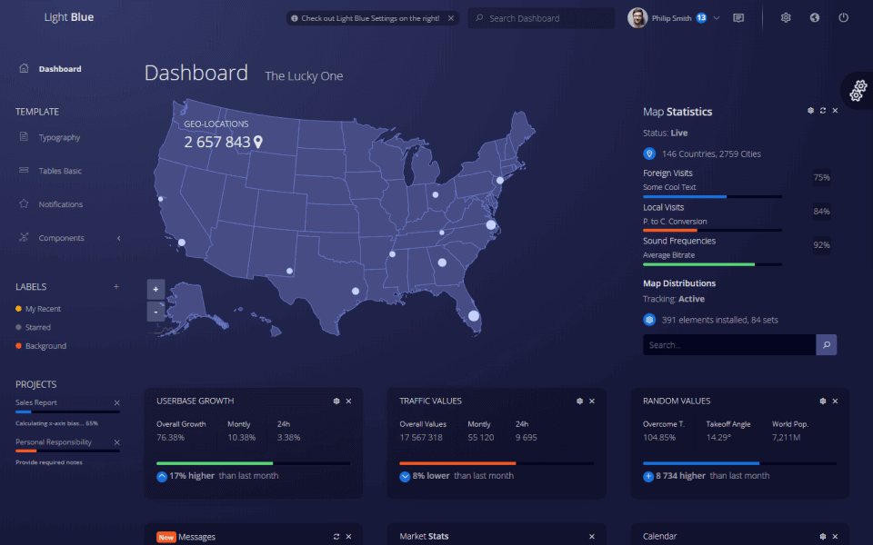

# 🤘 Vue admin dashboard template with stylish transparent design

Free and open-source admin dashboard template built with Vue.js and Bootstrap 4.6. Developed with ❤️ by [Flatlogic](https://flatlogic.com/). If you love our project please star ⭐️ our repo!

**Development at risk! Our developer wants to eat and accepted a job offer from McDonalds! Buy a [full version of Light Blue Vue](https://flatlogic.com/admin-dashboards/light-blue-vue/) to help us hire him again!** *

[View Demo](https://flatlogic.com/admin-dashboards/light-blue-vue-lite/demo) | [Download](https://github.com/flatlogic/light-blue-vue-admin/archive/master.zip) | [More templates](https://flatlogic.com/admin-dashboards) | [Support forum](https://flatlogic.com/forum)

[](https://flatlogic.com/admin-dashboards/light-blue-vue-lite/demo)

This dashboard, a lite version(containing only a few components) of our [Light Blue Vue Full](https://flatlogic.com/admin-dashboards/light-blue-vue), includes a selection of ready-to-use components found in the full version, offering a glimpse into its capabilities. Built with Vite and the Vue 3 migration build, it ensures wide support across the web, providing developers with a reliable and scalable foundation for creating [business software](https://flatlogic.com/) with a focus on usability and modern web standards. You can easily customize the template by changing SCSS variables. All paddings and colors are in _variables.scss file.

## Features

Light Blue Vue admin dashboard is a great template to quick-start development of SAAS, CMS, IoT Dashboard, E-Commerce apps, etc  
Lite version of a Light Blue includes following features and pages:

* Bootstrap 4.6 & SCSS
* Responsive layout
* Vue Chart.js
* Simple login / logout 
* Error page
* Styled Bootstrap components like buttons, modals, etc


## Pages
We have implemented some basic pages, so you can see our template in action.

* Dashboard sample
* Typography
* Tables
* Notifications
* Charts
* Icons
* Maps
* Chat
* Login
* Error page

## Instalation 

1. Clone repository
```shell
git clone https://github.com/flatlogic/light-blue-vue-admin.git
```
2. Get in the project folder
```shell
cd light-blue-vue-admin
```
3. Install the locked dependencies with npm
```shell
npm ci
```

## Quick start
Run development server
```shell
npm run serve
```

## Support
For any additional information please go to our [**support forum**](https://flatlogic.com/forum) and raise your questions or feedback provide there. We highly appreciate your participation!

## How can I support developers?
- Star our GitHub repo :star:
- [Tweet about it](https://twitter.com/intent/tweet?text=Amazing%20dashboard%20built%20with%20%23VueJS%20and%20%23Bootstrap!&url=https://github.com/flatlogic/light-blue-vue-admin&via=flatlogic).
- Create pull requests, submit bugs, suggest new features or documentation updates :wrench:
- Follow [@flatlogic on Twitter](https://twitter.com/flatlogic).
- Subscribe to Flatlogic newsletter at [flatlogic.com](https://flatlogic.com/)
- Like our page on [Facebook](https://www.facebook.com/flatlogic/) :thumbsup:

## More from Flatlogic
- [Awesome Bootstrap Checkboxes & Radios](https://github.com/flatlogic/awesome-bootstrap-checkbox) - ✅ Pure css way to make inputs look prettier
- [React Native Starter](https://github.com/flatlogic/react-native-starter) - 🚀 A powerful react native starter template that bootstraps development of your mobile application
- [React Dashboard](https://github.com/flatlogic/react-dashboard) - 🔥 React Dashboard - isomorphic admin dashboard template with GraphQL
- [Sing App](https://github.com/flatlogic/sing-app) - 💥 Free and open-source admin dashboard template built with Bootstrap 4
- [Light Blue Dashboard](https://github.com/flatlogic/light-blue-dashboard) - 💦 Free and open-source (no frameworks) admin dashboard template built with Bootstrap

## Premium themes
Looking for premium themes and templates? Check out our other template at [flatlogic.com](https://flatlogic.com/admin-dashboards).

## License

Light Blue Vue Lite version is [MIT](https://github.com/flatlogic/light-blue-vue-admin/blob/master/LICENSE)-licensed.

* that's a joke actually, but we would really appreciate if you support us by buying a premium version. Anyways free is just free and is limited to only few components, while premium one has more and comes with premium support.

## Dependency maintenance (2026-11-05)

Use Node 22.12+ (verified on Node 22.23.0/npm 10.9.8) and the canonical committed npm lock. The obsolete Yarn graph has been removed; no workspaces or scripts consume it. Clean npm installation and the complete production/development npm audit pass with 0 known vulnerabilities. Run:

```sh
npm ci
npm run lint
npm run build
npm test
```

The existing Bootstrap 4 SCSS theme, sample pages, routes and demo login remain in place. BootstrapVue 2.23.1 officially supports the Vue 3 migration build in MODE 2; this keeps existing Bootstrap 4 UI behavior while replacing the unsupported Vue 2 runtime. The scoped `portal-vue` Vue peer override selects the same Vue 3 runtime used through the documented compatibility alias, rather than installing a second vulnerable Vue 2 runtime. Bootstrap collapse, tabs and dropdown behavior are covered in production Chrome. Compatibility deprecation warnings remain visible in development; Bootstrap 4 and Vue Toasted remain deprecated libraries without current audit findings. A future BootstrapVueNext/Bootstrap 5 migration is a separate UI change.

Chart wrappers now use Vue 3 APIs: ApexCharts 5, ECharts 6 (v5 theme), Highcharts 13 and Chart.js 4 preserve existing chart data and configured colors. The native number tween retains the existing 2-second numeric animation without bundling Vue 2. VCalendar 3 retains the calendar dates and popover content. Google Maps uses a Vue 3 component and the existing public configuration; live provider access is not exercised by the local regression.

The Playwright regression uses local Chrome against the production build at `/light-blue-vue-admin/`. It exercises email/password demo login, dashboard map/calendar/charts, animated statistics, Bootstrap dropdowns, sample table images, toast actions/placement, chart widget collapse/expand, icon tabs and logout. A second test verifies login and Bootstrap sidebar opening/navigation/closing at 390px. The calendar popover is checked by hovering a real event date. Both production tests pass with no page errors, console errors/warnings or local missing assets. The router waits for initial navigation before mounting so a direct login/hash URL is respected. The existing false-authentication redirect takes precedence over the dashboard default redirect. This remains demo authentication, not a server authentication implementation.

Production assets retain the existing hosting path. `npm start` serves the built app with Express; `npm run preview` previews it locally. No deployment runs during these checks. Sass deprecation and large-bundle warnings remain visible.

Migration references: [BootstrapVue Vue 3 support](https://bootstrap-vue.org/vue3/), [Vue migration build](https://v3-migration.vuejs.org/migration-build), [Router initial navigation](https://router.vuejs.org/guide/advanced/transitions.html#Initial-navigation-and-transitions), [Chart.js 4 migration](https://www.chartjs.org/docs/latest/migration/v4-migration.html), [Highcharts modules](https://www.highcharts.com/docs/getting-started/version-12), [VCalendar 3](https://vcalendar.io/getting-started/installation.html).

GitHub Pages serves the tracked `docs/` directory from `master`. Refresh the complete generated demo after source/dependency updates, preserving any human-authored files:

```bash
npm ci
npm run build -- --base=/light-blue-vue-admin/ --outDir=docs
touch docs/.nojekyll
```

The existing hash routes use the repository base path. Commit the rebuilt assets together with `index.html` and remove obsolete hashed chunks.

The `.nojekyll` marker keeps the generated static files out of Jekyll processing.
